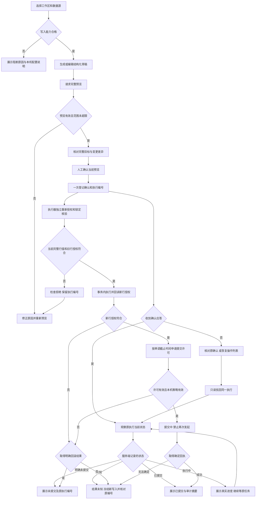

# 第八阶段界面流程与原型说明

**状态：2026-11-01 G1 与第 20 号修订已获用户通过，正式 G3 组件与隔离浏览器核验见 [21](21-第八阶段G3实现与审核记录.md)，真实产品写入关闭。** 本文件的独立 G1 原型继续保留为交互参考；其虚构数据不能连接模型、API、Connector 或数据库，模拟成功不是真实执行。正式组件位于 `src/mutations/`，不导入 G1 原型。配套 [安全与架构设计](17-第八阶段受控写入设计与审核.md)。

## 1. 入口与页面

正式实现建议在工作台增加“受控写入”独立入口，保留现有只读入口。自然语言生成和手工表单都先生成草稿，不能从聊天直接跳到执行。

| 页面 | 用户要判断的事 | 主要动作 |
| --- | --- | --- |
| 写入能力检查 | 当前空间、来源、Connector 和本机写配置是否合格 | 查看本机配置说明、重新检查；不在 Web 输入数据库密码 |
| 变更草稿 | 新增/修改/删除哪张表、哪些记录、哪些值 | 查看模型发送范围、生成候选草稿、编辑、请求预览 |
| 完整预览 | 全部目标、实际变更数量和前后差异是否正确 | 分页核对、返回修改、进入确认；超过上限整笔阻止 |
| 确认弹窗 | 对当前有效预览明确作出一次决定 | 默认焦点取消；勾选范围确认；删除还需输入表名 |
| 确认核对 | 原确认是否已登记，是否存在迟到请求 | 按原确认号核对；无法确定时保持等待，不生成新确认 |
| 执行进度 | 当前步骤、是否还可取消、结果能否确定 | 提交前请求取消；提交中等待；离开页面仍可查原编号 |
| 结果及审计 | 成功、确定回滚、未执行或结果未知 | 查看脱敏记录；未知仅查原回执和核对指引 |
| 操作恢复 | 页面临时编号丢失后，原任务在哪里 | 重新登录后查当前范围的待处理及最近执行；找回原记录，分别展示编号与结果 |

## 2. 主流程



此图描述未来产品行为。登记成功后执行器独立运行，不以页面是否收到应答为前提；“找回同一执行”只切换观察对象，不投递任务或重跑事务。恢复后展示该记录当前真实阶段，不从图中的某一步重新开始。当前可点击原型只演示有限状态，不签发任何许可。

## 3. 草稿与模型发送

主标题“受控写入”，固定显示当前工作区、数据源、目标表和来源模式；不得只显示一句“已连接”。权限说明区展示哪些操作/字段可写、最大影响行数和本机配置状态。

新增展示待新增的有界行；修改展示筛选及字段新值；删除展示筛选与不可撤销说明。明确列出“不允许”的字段和对象。模型生成的内容标为候选，用户可修改，但一经修改原预览作废。

明确说明行权限约束的是哪些数据：新增后的行必须满足范围；修改前后的行都必须满足范围；删除前的行必须满足范围。范围依赖字段默认受保护；本机策略允许变更时仍不能越出授权范围。数据库默认值和实际写后值也需核对。输入校验、预览和写后检查由 Connector 执行，页面提示不能代替这些检查。

调用模型前复用发送范围核对：目标模型、当前问题、获准的结构和非敏感语义逐项展示，不带预览行或数据库凭据。写入需求与值可能敏感，默认只留本页内存；不把它们自动保存为第七阶段对话。

## 4. 预览页

上部是可扫描摘要：操作类型、数据源/表、完整目标数、实际改变数、无变化数、预览期限，以及“仅针对本次列出的主键，新匹配行不自动加入”。主区按行展示主键、可查看标识、变更前和变更后；多字段按列分组，文本明确“原值/新值”，不能只靠红绿颜色。

最多完整 100 行，按 20 行分页；页面“预览前 20 行”必须同时告知完整目标总量。服务端缺少完整集合或超限时，不显示可确认的截断预览。敏感值按单独查看权限展示，未授权值不泄露。INSERT 的自增键和数据库生成时间显示“执行时生成”，不伪造实际结果。

底部只有“返回修改”和“核对并确认”。过期、结构变化、执行时当前完整行值与预览不一致或授权撤销时，确认失效；主按钮变成“重新预览”，不会自己继续。

并发说明使用准确文案：“执行时再次核对当前完整行值；与预览不一致则停止。”整行指纹不能检测期间先变动再恢复原值的全部过程，也不能区分同主键同值重建。页面不得承诺“期间发生过任何修改都能发现”；当前方案不要求给用户源表增加版本列或触发器。

## 5. 确认弹窗

- 复用 Base UI：焦点限制在弹窗内，打开默认聚焦“取消”，支持 Escape。确认和取消均有清晰按钮；点开弹窗不发送执行请求。
- 展示操作、来源、表、目标数量、实际变更数量及期限。勾选“我已核对本次预览中的全部目标与变更内容”。
- DELETE 额外显示“删除后无法通过平台撤销，请确认已有所需备份”，并要求输入完整表名。不是让模型填入确认词。
- 确认期间防止重复点击，内容/来源变化使旧弹窗失效。确认响应丢失转“正在核对本次确认”，不允许再建新执行编号。
- 不承诺“已勾选就一定安全”；最终授权、目标核验及事务仍由程序执行。

确认登记前后分开呈现：等待登记时显示原 `confirmationId`；服务端登记后显示关联的 `executionId`。同一预览只能被一次消费；重复确认不得再建一个执行。确认按钮事件须携带所见预览的身份和修订，旧弹窗事件不能作用于新草稿。

“查询暂未发现登记”只说明本次读取时没有记录，不代表延迟中的请求永远不会到达。界面保持“仍在核对”，提供正式设计中的“结束原确认并核对”动作：服务端在与确认登记相同的作用域锁/事务中关闭未登记意图并使旧预览失效；若已登记则返回原执行。只有取得这个确定结果后才允许新草稿进入确认。普通 GET 查询不关闭确认、不解除冻结、不派发 DML。

## 6. 执行过程

固定步骤为：重新确认授权 → 锁定并核对目标 → 事务内执行与新行授权复核 → 申请提交许可 → 提交中 → 核对回执。实际实现只能根据真实事件更新，不能用定时器伪造百分比或成功；原型使用定时器时明确标为模拟。

| 状态 | 文案示例 | 可用动作 |
| --- | --- | --- |
| 等待连接器 | 等待本机接收此任务，尚无执行结果 | 请求取消、查状态 |
| 确认应答丢失 | 正在核对原确认，尚不知道是否已登记 | 仅查原确认；页面信息丢失时从恢复入口查记录 |
| 核验/执行中 | 正在核对目标；或正在事务内执行，尚未提交 | 请求取消；等待明确回滚前不说“已取消” |
| 提交中 | 数据库可能已经提交，暂不能保证取消 | 查原状态；不显示“再次执行” |
| 成功 | 已收到明确提交回执，实际变更 N 行 | 查看执行元数据和审计；无自动撤销 |
| 拒绝/失效 | 目标/权限/期限已变化，本次未提交 | 返回修改、重新预览 |
| 已回滚 | 已确认事务回滚，本次业务数据未提交 | 修正后重新预览；不自动重试 |
| 结果未知 | 没有确定提交回执，数据可能已经改变 | 仅查原回执、核对指引；禁止自动重试和该来源的新写入 |

确定提交后的日志故障，显示“已提交；本机记录异常，后续写入暂停”，不能改成失败或“未写入”。未知不是普通网络错误。

执行编号与结果始终分栏。超限/过期等预览拒绝显示“尚未创建执行”；登记后权限或目标核验拒绝仍保留原执行号，另列“本次未提交”。“没有提交回执”不能代替执行编号，也不等于数据库未提交。许可超时只有在取得可靠回滚结果后才显示“已回滚”；否则转未知。

提交许可的 3 秒是 Connector 首次申请前启动的本机含休眠计数预算，不是页面倒计时或数据库完成时限。最终计数采样是锁内的一次提交交付资格点，须预留 100ms；不承诺网络发送或数据库提交完成于硬实时三秒内。延迟响应、重复查询、墙钟回拨不能延长资格；任一端进程重启后旧许可只可查询。交付后超时不能显示“未提交”，界面按真实回执或未知呈现，不通过刷新或再次点击修复许可。

## 7. 恢复指引

### 7.1 确认应答丢失、刷新或重新登录

正式产品提供“待处理与最近执行”入口。恢复只需要重新认证后选择当前工作区、数据源；服务端按当前管理员和当前范围返回脱敏执行记录，包括最近已成功/回滚/拒绝的记录，不能只列正在运行的任务。即使原任务在刷新期间完成，用户仍能找回它。列表可分页查看更早记录；不依赖用户事先抄下编号，也不在浏览器保存参数或预览行。

用户仍持有原确认号时先只读查询其登记状态。全部临时编号丢失时，恢复动作还要建立服务端屏障：与确认登记互斥地作废该管理员当前范围内所有未消费预览，再列出此前已登记的执行记录。已登记操作保持原编号和生命周期；尚在网络中的旧确认不能越过屏障登记。屏障不取消已登记任务、不解除未知冻结、不发送任何 SQL。

执行恢复屏障前清楚说明：“会使本工作区、该数据源下你其他页面尚未确认的预览失效；已登记操作继续按原编号核对。”普通打开记录列表是只读操作；建立屏障是单独明确动作，不能把它暗藏在轮询或 GET 请求里。

恢复记录展示确认号、执行号、操作、表、时间、阶段和提交事实，不显示 SQL、参数或原始行。打开记录只观察同一操作；它可以已经拒绝、已提交或结果未知，不能被恢复页面重新“启动”。因权限撤销暂不可见时展示“当前无法核对，勿重新提交”，重新登录或恢复必要查看权限后继续核对。

### 7.2 结果未知

未知状态突出原执行编号、操作、来源、时间和已知事实，隐藏具体参数与原始行。先恢复 Connector 和日志可用性，只读核对同事务目标回执与原签名回执；缺失回执不能推断未执行，也不解除冻结。任一服务重启后旧操作只可查证，重新操作需要新预览与人工确认。平台和日志同时恢复旧备份时，界面不得因列表为空就显示安全可写；数据库及回执也回退时进入维护恢复流程，不能自动解冻。

人工核对只能留下与机器回执区分的备注。界面不提供“假定失败并重试”或“一键改为成功”。需要解除来源冻结时另行明确确认风险，仍不重跑原编号；要做新变更必须从新草稿、预览、确认重新开始。

加密核对包只留 Connector 本机、最多原预览创建起 24 小时，界面显示到期时间；不把保留资料当作继续执行的许可。G3 已实现固定期限、独立包密钥和启动/运行时清理，停机、备份和物理擦除限制见第 21 号记录；系统实际部署边界仍需 G4 验证。

## 8. 可点击评审原型

审核入口：[打开本机交互原型](http://127.0.0.1:8768/)。这是独立评审页，现有工作台的菜单尚未接入该功能。源码为 `apps/community-web/src/stage8-review/`，独立 HTML 和构建配置；不进入正式工作台路由，生产主入口不导入原型。复用项目的 React、Base UI 和 Lucide，无新前端依赖。

在项目根目录构建和启动（服务器已在本次审核中启动）：

```powershell
pnpm --filter @workspace/community-web review:stage8:build
pnpm --filter @workspace/community-web review:stage8:serve
```

默认只监听 `127.0.0.1:8768`；构建结果在 `.cache/stage8-review/`，原型没有账号登录和数据库配置步骤。结束评审服务不会停止正式平台或 Connector。

原型包含新增、修改、删除；正常成功、执行时当前值不一致、权限撤销、超限、过期、确定回滚、提交后断线未知，并增加确认应答丢失、行范围越界和提交许可超时的预设场景。可核对原确认、从演示记录找回原执行，查看本机授权说明和未知核对指引。评审工具栏的“重置演示/场景选择”只重置虚构界面，不是正式产品的重试入口。模拟状态不证明真实数据库有任何变化。

“模拟刷新/重新登录”只清空页面所持编号、弹窗与确认意图，保留本次演示中的独立内存记录，演示正式产品从服务端找回记录的流程。它不执行真实浏览器刷新或认证；实际刷新整个静态页面会重置全部演示数据。没有新增持久化、后台服务或真实恢复协议。关闭意图/恢复屏障的真实并发正确性须在后续 G2/G3 验证，不能由界面模拟证明。

原型使用预设结构化草稿；修改示例可在“重点/潜力”之间选择新等级，返回编辑会使旧预览失效。自然语言草稿只展示示例，不在原型中解析或调用模型；真实模型接入、分页大数据和安全行为留待后续实现验证。

静态评审服务器只监听本机，响应 CSP 禁止网络连接和表单提交；不代理 `/api`，不读取环境中的数据库或模型凭据。自动检查确认原型无 API 客户端导入、无 fetch/WebSocket、无浏览器持久化；浏览器网络记录确认加载仅为 HTML、JS、CSS 三项静态资源。静态页入口请求并非业务 API 请求。

## 9. 评审走查清单

1. 修改：请求模拟预览 → 核对三行前后差异 → 取消确认 → 再次确认 → 看完整进度和成功。
2. 删除：未勾选或表名不匹配时不能确认；完成后明确没有平台撤销。
3. 新增：预览显示输入，生成键不伪造；看模拟成功结果。
4. 目标变化/权限撤销/过期：旧预览失效，必须返回重新预览；超限不得部分执行。
5. 确定回滚与提交后断线：前者明确未提交，后者保持未知，不能通过“查询状态”伪造成功，也没有自动重试。
6. 提交阶段取消不可用；重置演示或切换场景不会遗留旧计时器继续推进。
7. 键盘 Tab、Escape、焦点恢复、窄屏横向表格和长文本不遮挡确认动作。
8. 确认应答丢失后核对原确认，找回同一执行；重复核对不产生新执行。模拟页面丢失编号后，从记录列表恢复同一操作；已完成记录仍可找到。
9. 目标/权限拒绝后执行编号仍保留；超限/过期等预览拒绝明确尚未创建执行。行范围越界和许可超时都不能显示提交成功。

本轮检查结果见 [阶段记录](17-第八阶段受控写入设计与审核.md#11-本次审核记录)。用户审核重点是范围、理解成本、确认步骤和失败恢复；真实写入功能留待设计通过后开发与验证。
