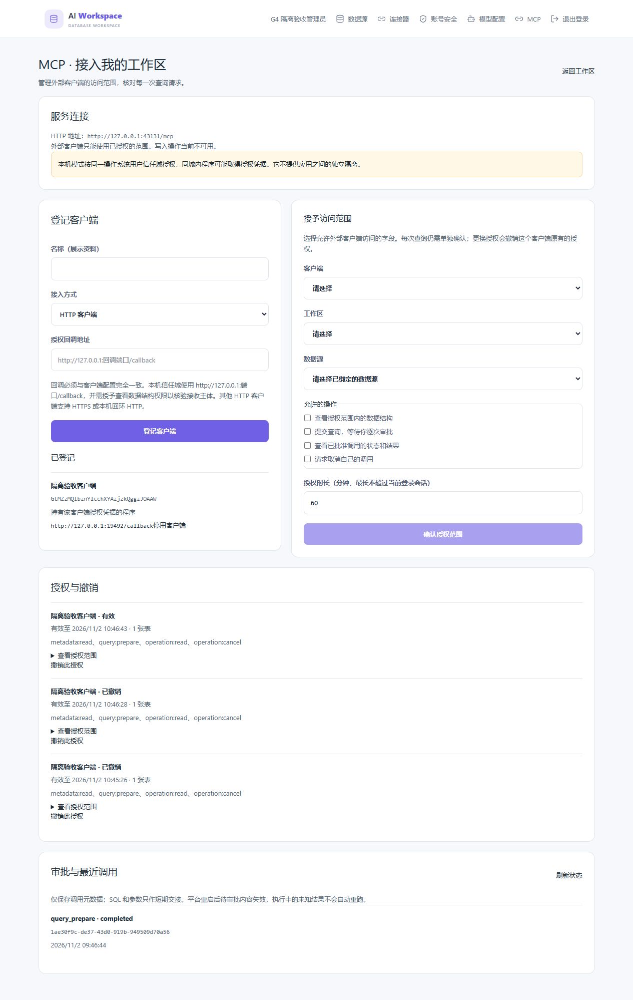
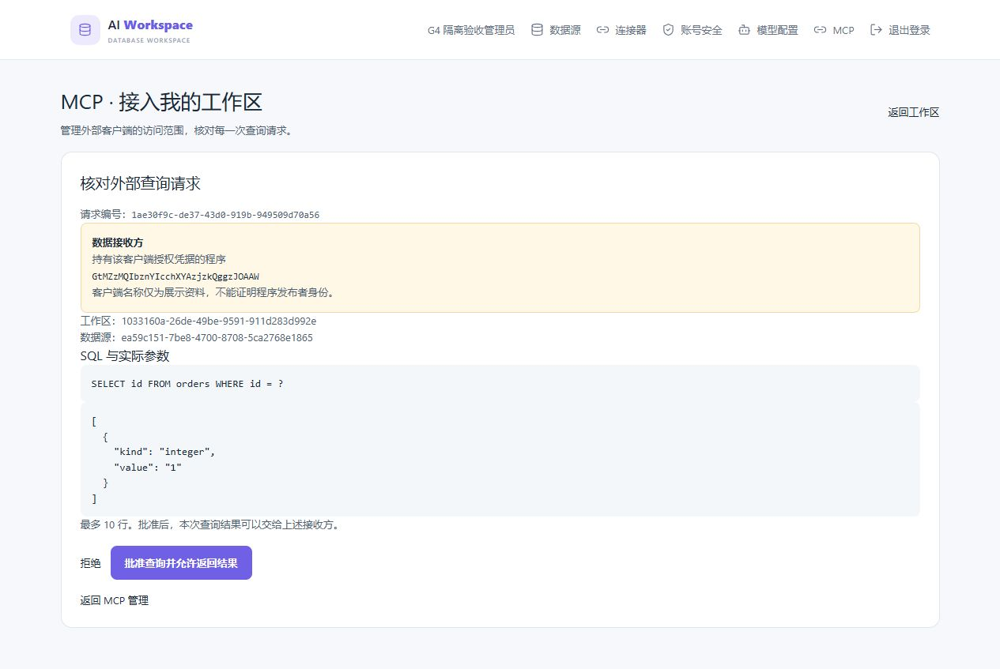

# 第九阶段 G3：MCP Server 实施与审核

2026-11-02 更新。用户已审核通过 G2 并授权继续完成 G3；继续只使用新建的独立测试数据库，不操作原数据库。

**状态：G3 Server 的当前只读及写门禁关闭组合已获用户审核通过，用户已授权开始 G4 Client。第九阶段整体尚未验收。** 本阶段目标和安全边界以 [第九阶段设计](26-第九阶段MCP设计与验收计划.md) 为准，G2 证据见 [隔离技术验证记录](27-第九阶段G2隔离技术验证与审核记录.md)。下方“此前基础实现记录”保留当时进展，不代表当前仍缺少那些已接入的能力。

## 本次产品实现

本次 Git 起点为 `d14ab200e283087d06f6fa06b16a450830b071bc`，开始时工作区干净；本轮改动尚未提交或推送。正式 MCP 默认关闭，未替用户的平台数据库执行迁移或启用功能。

- Server 复用官方 `@modelcontextprotocol/server` 2.4.0、Node 适配器 2.1.2、Better Auth MCP/OAuth 1.7.14；本地适配器复用官方 Client 2.4.0。证书生成采用 `selfsigned` 5.5.0（MIT），使用 Node 原生 TLS 验证，不实现自制加密协议。SDK、认证端口、授权应用服务、存储适配器、传输入口与 UI 分开组织。
- `auth/mcp-provider.ts` 拥有 SDK OAuth 数据与过期清理；`mcp/store.ts` 拥有客户端、授权世代、令牌哈希关联与调用元数据。认证模块公开真实会话期限证明；MCP 不直接读写认证表。显式迁移 `007-mcp-server.sql` 使用独立 MCP 版本与结构指纹，启动仅验证列、索引和外键，不自动修库。
- 管理页提供登记/停用客户端、选择真实工作区及已绑定数据源、按扫描结果选择字段、选择操作和时长、逐次查询审批、最近调用和撤销。加载失败与空记录分开显示，可重试；跨页选择与旧请求返回不能带入另一个工作区。
- 六个工具为 `workspaces_list`、`datasources_list`、`schema_get`、`query_prepare`、`operation_status`、`operation_cancel`。仅有 `metadata:read` 时，状态工具只允许读取该授权的结构调用，不能借此获取查询结果。写门禁关闭，不提供 `change_propose`，不接受 DML/DDL 或客户端伪造的批准状态。
- OAuth 使用预登记客户端、精确回调、PKCE S256、state、resource、issuer 和实际登录会话。禁用匿名动态登记、刷新令牌和原始 SDK 同意/内部核验接口。授权码一次使用；只有核实过的码所属授权可消耗该授权的交换额度，其他失败请求不占它的额度。
- HTTP 资源监听独立回环端口；每次调用重新核验授权、工作区绑定和 Connector。原始请求最多 64 KiB，参数 32 KiB、Header 8 KiB；深度、成员、节点、并发、速率和绝对收包期限均有上限。连接只接受一次请求，避免复用连接绕过 Header 截止。
- 本地 stdio 按同一 OS 用户信任域授权，并不隔离该用户下的应用。适配器只接收系统凭据库引用，不接受令牌、数据库凭证或任意启动命令。独立 TLS 1.3 回环通道的临时证书由平台生成，其可信描述通过当前 OS 用户凭据库交接；在 TLS 验证成功前不会向该连接发送 bearer 或授权码。CLI 发现与交换只走精确映射的受信通道，不从网络自建信任，不修改系统根证书，也不关闭证书验证。
- 短期 SQL/参数只在有界内存中交接，2 分钟、单项 32 KiB、进程总额 2 MiB，以持久系统密钥生成承诺。持久调用记录保存元数据与承诺，不保存 SQL、参数或结果。外部请求编号与随机内部任务编号、nonce 分开，禁止读取/取消普通查询或其他授权的任务；重启把待审批标为过期、在途标为结果未知，不自动重跑。
- 真实查询审批会话可能不同于授权会话。派发与结果发送同时锁定这两个实际会话和授权世代，发送还保持工作区绑定；撤销与发送排序到响应结束/断开。物理核验超时后，晚到回调在最终派发/发送处再次检查租约，不能继续使用已销毁连接上的权限。审批会话退出后，后台主动取消在途读取，不依赖客户端轮询。
- 所有工具在业务执行前经过持久审计门禁。工具事件显式带工具名、稳定调用编号、授权编号及客户端编号；请求接受、调用登记、结果披露获准分别表示实际发生的动作，不把披露获准写成已送达。管理请求中断记为未知；不能为了返回超时而让后台变更继续后又记成失败。
- 元数据维护与会话监测分开运行。撤销或过期满 7 天的授权元数据、认证模块过期凭证元数据按每分钟有界批次清理；活跃授权保留幂等记录。7 天是可清理条件，大量积压可能晚于该时点完成。客户端登记资料与审计沿用显式停用/既有保留规则，不声称一并自动删除。授权观察容量健康接口为 `/api/mcp/health`；因物理工作结束无法证明而保留名额时，需检查脱敏日志并重启平台恢复，不能默默复用名额。
- 取消、拒绝、失败、到期和服务关闭共用粘性清理意图：先同步撤销执行能力、清除 bearer 和交接内容、取消拥有的任务，再由独立最多 2 个物理写入补记状态。队列只保留调用/授权/世代/启动编号、承诺及终态元数据；与活跃调用合计最多 128 条，不保留 SQL、参数、结果或敏感回调。失败重试不占 8 个授权监测名额；状态更新同时匹配全部归属标识，不能改写其他调用。健康接口分别报告授权观察与清理积压。
- 预备调用在异步登记前就归生命周期管理。关闭时立即擦除其敏感内容；登记晚到后只能补写终态，不能重新激活审批。正常关闭最多等待 1 秒补记；无法完成的物理写入不伪称已取消，下次启动按已有恢复契约处理残留元数据。在途读取未获得真实结果即取消时记为结果未知，已核实完成的执行事实不因结果清理而改写。
- 结果使用墙钟和单调时钟中更早的期限；传给 Node 超时信号的毫秒数取整。对捕获的查询/结构结果，在持锁披露及最终写入时再次核对实际任务编号、nonce、审批会话和仍被保留的原 payload；语义变更导致结构结果被清除后不能再发送捕获副本。
- 到期和非成功终态采用同步遍历及独立计时，不排在异步授权监测后面。拒绝审批先清理再补记，不多读一次数据库；失败任务的取消/状态读取也先清理，不等待元数据或会话 IO。原始请求编码在同步交接后立即清零；批准只携带授权和承诺跨越等待，最终持锁授权内才解析交接 SQL 并创建拥有的有界 ReadJob。
- 清理失败的行轮转到队尾，避免阻塞其他可补记记录；关闭等待期间每 100 毫秒驱动重试，仍只有 2 个物理写入。正在返回的旧数据库快照使用有界读取租约：已补记的终态说明暂存到读者结束，最多 64 个并发元数据读取，其保留说明仍计入 128 调用预算；不缓存结果或形成无限历史。读取结束后的快照有明确观察时点，不承诺响应后状态永远不变。
- 并发审批在任何后续 IO 前只允许一个获胜者；竞争失败的请求不能替换或取消获胜任务，获胜者的元数据读取失败也进入统一清理。任务 nonce 与执行守卫的实际所有权显式记录，清理意图只转交队列一次。状态读取的临时 bearer 副本随清理/退出擦除；授权事务和工作区包装器只传递元数据，全部等待结束后才同步获取、解码结果，所有返回分支先核验生命周期。已清理时只能返回不含结果的已知终态；网络披露仍独立核验当前授权、两次真实审批会话和实际保留数据。

## 运行与审核方法

仅在选定平台库已完成既有阶段迁移、用户明确允许迁移该库后运行 `pnpm --filter @workspace/community-api db:migrate:mcp`。随后设置 `ENABLE_STAGE9_MCP=1`、准确的 `MCP_RESOURCE`、`MCP_PORT`，保留阶段 3/4/6/7 前置配置并重启。示例配置默认值不构成原库操作授权。

本地模式先在管理页登记“本机同用户信任域”，回调必须为 `http://127.0.0.1:端口/callback`；选择范围时包含 `metadata:read`，用来核实接收主体。登记错误可停用后重新登记。登录命令的参数依次为：新生成的 UUID 引用、准确资源 URL、准确发行者 URL（平台对外 origin 加 `/api/auth`）、客户端 ID、登记回调、空格分隔的已批准 scope。命令为 `pnpm --filter @workspace/community-api mcp:local:login <上述参数>`；scope 省略时仅请求 `metadata:read`，不得自行扩大为所有 scope。当前本机 profile 的资源和发行者 URL 使用带明确端口的 `http://127.0.0.1`。按终端给出的地址在管理员浏览器同意后，系统凭据库保存最长 5 分钟的短期令牌；拒绝即结束，不发送令牌到终端输出。

OAuth 发行者位于平台公开 origin。开发用 Vite 已将两个确切的发行者发现路径代理到同一个 API 目标，避免客户端收到 SPA HTML；部署反向代理也需将 `/.well-known/oauth-authorization-server/api/auth`、`/.well-known/openid-configuration/api/auth` 和现有 `/api` 正确路由到平台 API。该发现代理有独立临时服务集成测试，未为此访问原平台。

客户端 stdio 启动使用当前受控安装中的 Node 与 `apps/community-api/dist/src/mcp-stdio.js <UUID引用>`，不通过下载式或 shell 拼接启动，不传数据库环境。令牌到期需重新登录，无自动刷新；平台重启更新本机通道的受信描述。当前验证的 profile 为 Windows/amd64、Node 24.19.0、MySQL 26.7.0、官方 SDK 2026-07-28 协议。真实第三方客户端、MySQL 8.0、Linux、本机不同 OS 身份、公网 HTTPS 反向代理与跨主机部署尚未验证，不能据此宣称正式支持。

## 本轮验证与原生审查

本轮使用独立实例 `70596170ca31496686a6a21ec64e6ebf`，端口 13308。每次测试连接核实目录、UUID、PID 和端口，只创建随机 schema/账号；未连接、迁移、修复或停止原数据库。真实 Go Connector 的测试读账号仅在合成数据源获得读取权限，MCP 正反测试核对允许字段能返回、越权字段被拒绝及源数据未变化。

浏览器已实操登记、选择实际扫描字段、授权、查看待审批 SQL 和参数、批准及最终完成状态。查询由独立环境的真实 Go Connector 执行。截图使用合成账号与数据，不包含真实用户凭证。

最终测试按实际执行集合分别记录，有重叠，不累加为总通过数：

| 验证 | 实际结果 | 范围 |
| --- | --- | --- |
| MCP 完整回归 | 76/76，0 跳过、0 失败 | 独立 MySQL、真实 Go Connector、官方 SDK HTTP/stdio、本机 TLS/凭据登录、慢输入、授权/撤销/审批、故障、并发、清理和保留 |
| 最后返回守卫调整后的定向复验 | 2/2 | 排队和已完成两种观察在授权提交返回前被清理，均不能返回旧状态/结果 |
| API 全量离线及协议回归 | 262 项：199 通过、63 明确跳过、0 失败 | 未提供额外数据库/凭据环境的用例关闭；真实 MCP 数据库验证单列在上方 |
| 前端 | 113/113 | 管理/审批组件、加载/错误/旧请求状态及精确发现代理 |
| Connector | `GOARCH=amd64 go test ./...` 通过 | 常规回归；真实受限 MySQL 执行另由 MCP 矩阵覆盖 |
| 工程检查 | 通过 | API/前端构建、工作区类型、Lint、格式及 TypeScript/Go 模块边界 |

前端构建保留既有 Zod 注释与约 1.04 MB 主包提示；不将构建通过描述为性能验证。

扩展回归曾发现失败任务的 bearer 擦除与终态读取竞争，已修复；审批绑定竞态测试的旧等待窗口未覆盖已启动观察的服务器锁等待，已改为包含既定 IO 截止并保留“不重新激活任务”的断言。注销独立审批会话的测试验证内部观察不含结果、最终实际披露拒绝，不能只依赖某个内部方法是否抛错。真实 Connector 验证 DML、DDL 及越权字段均拒绝，每次核对合成数据未变化。集成夹具须先编译，再用 `node --test` 运行 `dist/test/`；直接以源文件运行无法启动其编译后的子 API，不将该启动失败算成功能验证。

原生审查使用实际 Codex CLI 0.165.0 的只读 `review` 入口，排除凭据库和运行目录，不让 reviewer 连接数据库或执行测试。范围为本次 Git 差异（含新增文件）及直接受影响调用链；基准为上方干净任务起点。发现并修复了任务编号归属、不同审批会话、审计覆盖、并发登记/审批、交接清理、取消状态、限额、迁移指纹、登录恢复、TLS 服务身份、超时晚到回调、审计关联及数据跨异步提交保留等缺陷。修复后按受影响路径定向原生复查；最后一轮确认所有观察在包装器结束后先检查生命周期，已完成结果只在全部等待结束后同步获取。当前修订范围没有剩余已确认阻断问题，不将该结论扩大为所有部署组合安全保证。

独立实例 `70596170ca31496686a6a21ec64e6ebf` 收尾时再次核实非系统 schema、随机测试账号均为零；重验目录、UUID、PID 和端口后仅关闭该实例，确认进程退出、PID 文件移除、13308 端口释放。临时界面服务、API 和 Connector 已按本轮拥有关系关闭。未关闭、连接、迁移或修复原数据库；后续若需数据库复验须新建实例，不回退到默认库。

当前交付保持 MCP 默认关闭、正式写入关闭。写门禁关闭时不提供 `change_propose`；开放写门禁后的草稿交接与管理员重新预览仍属第九阶段后续验收矩阵，不声称已在本组合实现或验证。G4 外部 Client、G5 真实第三方客户端与总体验收尚未完成；MySQL 8.0、公网 HTTPS、跨主机及其他 OS 的支持范围继续待独立验证。功能目标保留，不以当前只读组合替代完整产品目标。

## 此前基础实现记录（历史快照）

下文保留 2026-11-01 的基础实现与早期独立测试证据。其中“尚未完成”等描述只针对当时；当前产品实现以上述本轮记录为准。

### 当时进展

- 已按 G2 选型将 MCP 官方 Server/Node SDK 与 Better Auth MCP/OAuth Provider 固定加入 Community API 依赖，禁用安装脚本，使用本机依赖缓存。配置与组件仍未挂载产品入口。
- 已实现独立授权判定、认证 SDK 令牌核验适配器和 MySQL 授权观察适配器。授权观察通过认证模块公开端口读取实际批准会话期限，最终 SDK 核验期间持有授权与会话锁；过期、注销、授权世代变化和 SDK 令牌撤销均失败关闭。数据库回滚失败或锁定核验超时时销毁该连接。
- MySQL 锁等待在服务器侧限时；若连接已销毁但无法证明服务器工作结束，该任务名额会保留到进程退出，达到上限后拒绝新授权核验。正式接入前仍需配套健康状态、可追踪诊断和明确的恢复提示，不能让管理员把容量耗尽误认为正常授权拒绝。
- 已实现短期审批内容的内存交接基础，限制单项 32 KiB、期限 2 分钟、总容量 2 MiB，并将授权、世代、请求编号、工具版本和内容绑定到有密钥的承诺。尚未接入长期密钥、持久幂等记录或真实审批流程，不能独立作为授权或执行入口。
- 审批交接的进程容量目前只支持 Node 主线程，工作线程调用会拒绝。期限计时目前只允许 Windows：Node 高精度时钟底层使用 QPC；依据 [Microsoft 对 QPC 的说明](https://learn.microsoft.com/en-us/windows/win32/sysinfo/acquiring-high-resolution-time-stamps) 和 [libuv Windows 实现](https://github.com/libuv/libuv/blob/v1.x/src/win/util.c)。Linux 的 `/proc/uptime` 虽可计入休眠，但 Node 定时器在恢复后不能保证立即唤醒清理；在找到并验证可用方案前，该能力在 Linux 和其他未验证平台失败关闭。这里只做来源核对和模拟时钟验证，未进行用户排除的实际休眠实验；G3 尚未完成，不能把这一限制当作最终产品支持范围。
- 已将只读任务的明确委托表/字段范围纳入由现有签名保护的 payload；Connector 在验签后将其与当前本机策略取交集，用于 SQL 校验。普通管理员查询显式使用 `null`，不改变本机策略。委托结构任务也使用签名范围与本机策略取交集；实际隔离 MySQL 测试核对了结构中不包含未授权字段。已更新共享签名向量和 [Connector 协议说明](../connector/PROTOCOL.md)。
- 首轮原生审查发现两个 P2：重复 JSON 字段可能覆盖委托限制、范围对象可能在限额前大量展开。已改为基于标准 JSON decoder 检查重复字段和确切字段名，并采用先检查长度的有界范围数组。后续审查发现了授权等待、服务器锁等待和审批数据交接的风险，修复包括有界请求、服务器锁等待上限、连接异常后的保守容量保留、进程共享容量、严格类型及双时钟期限检查。数据库锁等待的实际隔离验证已运行；接入产品时必须配置专用授权连接池，当前针对最终修订的原生复审与完整 G3 审查尚未完成。

## 已执行的验证

验证使用单独新建、guard 核验的 MySQL 26.7.0 回环实例；只创建随机测试 schema 和账号。测试没有连接、迁移、修复或关闭原数据库。

本轮原生审查使用 Codex CLI 的只读入口，按本次文件及相关调用链定向进行。主要范围包括 `apps/community-api/src/mcp/`、`apps/community-api/src/queries/jobs.ts`、对应测试、`connector/go/internal/protocol/read_task.go`、`connector/go/internal/agent/read_runner.go`、委托范围实现及其测试。工作区原有未提交修改不以 Git HEAD 冒充干净基线，也不纳入本轮结论。

本轮实例编号 `f83ae96233d94c91bffb8987fd0e3490` 的定向测试结束后，核实非系统 schema 和本轮随机测试账号均为零；重新核验该实例的目录、UUID、端口及拥有进程后，仅对该实例执行关闭，确认进程退出、PID 文件消失及端口释放。后续需要 MySQL 验证时必须再创建新的隔离实例，不回退到用户原库。

复审后使用新建独立实例 `8ce3138502df4f688b202880482fc359` 验证锁等待测试与本机权限更窄时的正反查询；结束时同样核对非系统 schema、测试账号为零并仅关闭该实例，确认进程退出、PID 文件消失和端口释放。

- Connector 定向用例验证签名篡改、重复字段、委托范围与本机权限交集；实际隔离 MySQL 中验证授权字段可查询、越权字段拒绝、普通管理员查询仍有效。
- Codex CLI 原生定向复审覆盖了授权核验、签名范围和审批交接；修复后的测试资源归属与本机权限收紧用例已复查，未发现剩余可操作问题。审批交接的最后复审及修订状态见下一项，不能由此推断整个 G3 已审查通过。
- 最后几轮只读复审确认计时和平台门禁方向，同时指出依赖检查遗漏带选项的动态导入、模块 URL、路径大小写及自测未核对实际拒绝原因。已统一导入识别、规范化模块路径、禁止 API 生产代码使用非静态或绝对文件导入，并让自测核对实际扫描逻辑和具体结果。扫描自测和实际 TypeScript/Go 依赖边界检查通过；最后一组路径修订尚未再作原生定向复查，不算 G3 最终审核通过。
- Community API 定向测试验证请求范围和签名绑定、授权判定、事务回滚失败处理、审批交接边界；7 项 SDK/独立 MySQL 集成用例验证实际注销、授权世代变化、SDK 令牌撤销竞态、元数据锁与 InnoDB 行锁等待超时，以及授权行锁释放。具体最终复审结果在本阶段完成后补记，不将早期结果累加为全量通过。
- 当前批次的 Community API 构建、44 项定向测试和 TypeScript/Go 依赖边界检查通过；其中审批交接的 14 项专项测试覆盖了期限、容量和失败路径。上述检查不代替尚未实现的产品流程、真实客户端与浏览器验收。

### 当时尚未完成

- 正式 OAuth 客户端登记与审批、授权范围持久化及迁移、撤销和受限管理 API；不能开放原始 SDK 同意或内部令牌核验端点。
- HTTP/stdio MCP Server 的产品接入与限额、工作区/数据源/结构工具，以及同 OS 用户信任域的本机凭据交接。
- 真实管理员逐次审批、签名任务派发、结果披露及取消的完整链路；写入草稿交接和现有写入门禁。
- MCP 管理与审批界面、真实浏览器流程、安全/故障/并发回归、完整代码与安全复审及阶段审核。

以上工作完成和验证前不得称 G3 已完成或开放产品 MCP。MySQL 8.0、真实第三方客户端、公网 HTTPS、跨主机及独立 OS 身份隔离没有因本阶段开始而获得验证。
