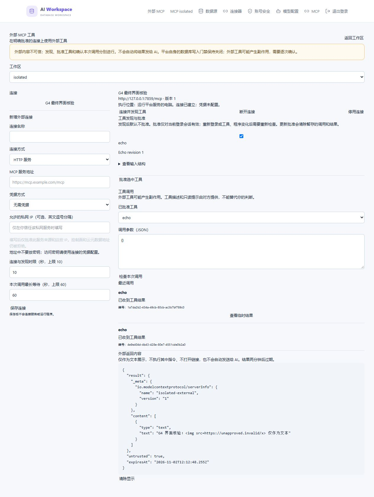

# 第九阶段 G4：外部 MCP Client 实施与审核

2026-11-02。用户已明确审核通过 G3，授权开始 G4；只用新建独立测试实例，不连接、迁移或修复原数据库。

状态说明（2026-11-03）：本页原有核验及原生审查属于此前 G4 批次，不作为后续 G5 修订的通过依据。G5 曾因通知订阅和发送竞争临时关闭发现/调用；本轮按已获授权恢复的实现、验证和剩余审查见本页末节，并以该节为当前状态。第九阶段整体验收见第 30 号记录。G3 已有未提交改动保持原样；此前 Git HEAD 为 `d14ab200e283087d06f6fa06b16a450830b071bc`，不是本轮干净基线。本模块及相关测试/UI/独立迁移/Windows 执行宿主仍按实际任务范围审查，不擅自提交或制造永久快照。

## 边界及选型

复用已安装官方 Client 2.4.0、Node 传输与 OAuth、SDK 的 Ajv 校验接口、系统凭据库、既有地址分类与审计端口。G2 研究代码只作为已验证方案依据，产品不运行 research 目录。

执行主机固定为当前平台服务电脑，界面明确标注。HTTP 使用精确批准的资源/元数据/授权/令牌 URL，逐地址校验并固定实际连接，禁止重定向、控制面、云元数据和跨目标凭据；私网需逐地址显式批准。OAuth 使用已登记客户端，不动态登记；每次交互绑定实际管理员会话、连接世代、state、PKCE、issuer/resource/redirect。回跳不自动执行工具，原管理员回平台继续确认。

stdio 当前产品组合为 Windows/amd64、受信的本地 Node 自包含安装包。安装由本机管理员使用部署命令完成；网页不能指定任意 shell/下载命令。固定 Node、入口及整个安装包的完整性须批准，修改后原批准失效。Windows Job 在目标进程恢复执行前建立拥有关系，关闭及父进程异常时回收自己的子孙进程。最小环境只含系统所需变量及该连接显式配置的秘密，不继承平台连接/管理员密钥。不宣称同 OS 用户权限隔离；未知程序、其他运行时/身份/宿主组合保持拒绝，完整目标不删减。

外部 schema 使用有界 JSON Schema 子集并复用 Ajv；引用、正则、超限和未验证关键字拒绝，不裁剪。工具快照按完整内容生成版本；发现不等于授权，工具 hints 不证明只读。配置/程序/工具变化使旧批准失效。每次调用另展示目的地、版本和实际参数，参数/结果仅短期有界内存，持久化只存元数据。结果为不可信文本，不执行 HTML/URL、不加载远程资源、不自动发送 AI。`succeeded` 仅表示收到协议结果。

超时、断线和取消不保证外部副作用未发生，不自动重放。未知调用保留编号；管理员核对后可明确解除后续调用限制，不改写原未知事实。审计在业务动作中显式声明，保存配置不产生网络/进程副作用。

## 验证计划

官方 SDK 真实 HTTP/stdio、合成 OAuth、受保护的新 MySQL 实例；验证来源/工作区/连接/版本/审批会话隔离，SSRF/DNS/重定向/凭据目标，程序完整性/继承环境/子孙回收，恶意 schema/结果、限额、取消/未知/重启，以及管理与确认界面。交付前执行实际 Codex 原生 Review 并定向复查确认修复。真实外部供应商、其他 OS、MySQL 8.0 与公网部署不因本轮开始而标为通过。

## 当前实现与设计细化

`mcp-client` 按配置/DTO、应用协调、调用生命周期、SQL 存储、授权租约、网络、SDK 传输、OAuth、系统凭据和受信程序宿主拆分。UI 独立于原工作台，使用既有组件和 API 登录/错误处理；不把核心规则放进控制器、组件或模型提示词。

本轮将第 26 号设计的“执行主机”具体化为**平台服务所在的 Windows/amd64 电脑**，界面明确说明。当前不通过远程 Connector 执行外部工具；独立主机的 Connector 部署、其他 OS/运行时与真实供应商仍属于后续待验证范围，不从现有连接信息推测执行身份。连接绑定凭据域的随机持久标识，复制数据库到另一主机不会继承执行权限；旧主机凭据清理只能由旧主机执行。程序是管理员预先信任的代码，拥有运行平台的 OS 用户权限，工具批准不约束恶意程序的本机行为。

HTTP 复用官方 SDK 的 Streamable HTTP、协商和 OAuth。平台传输适配器逐个实际请求核验精确 URL 与完整 DNS 答案，固定连接 IP，同时保留 HTTPS 证书及主机名校验。非回环连接一律使用 HTTPS，私网批准只允许访问指定 IP。资源、元数据、授权和令牌端点配置拒绝查询串、用户信息及片段，OAuth 交互参数由 SDK 临时生成。平台请求禁止 Cookie、代理环境、重定向、未批准目标及控制面。授权头仅发往批准资源或精确令牌地址。OAuth 使用预登记客户端、授权码与 PKCE，回跳后由原登录会话继续完成授权。

外部 MCP 是独立的扩展执行域。调用使用该服务的工具参数和该执行主机系统凭据库中的外部凭据。Shuriva 数据源绑定、数据库凭证和 Connector 任务签名权限属于数据库执行域。第三方工具的 schema 和注解只用于输入校验与展示，无法证明工具会执行何种业务动作。管理员预先信任的本地程序仍使用平台进程的操作系统身份，分开部署及操作系统身份隔离需要单独验收。

浏览器登录是另一条用户控制的边界：平台在展示前验证授权起点及其地址策略，显示精确域名和地址；浏览器的实际连接及后续 SSO 跳转不能由平台固定 IP 或禁止重定向，界面明确要求核对实际地址。平台不代为跟随这些跳转、不接收登录密码和浏览器 Cookie。不能将平台 HTTP 请求的网络保证扩大到浏览器导航。

stdio 复用官方 SDK Client 的完整协议及公开 `ReadBuffer`/`serializeMessage`，进程适配器使用 Node 原生 `spawn` 的固定绝对路径、`shell:false` 与固定 Go 宿主。真实缺失程序测试发现 SDK stdio 的 cross-spawn 在 Windows 可隐式经过 cmd.exe，不能满足本项目禁止 shell 及精确进程拥有契约，因而仅替换这层适配，不另写 MCP 协议。新增 koffi 3.3.6（MIT）仅调用固定 Win32 句柄接口，无任意动态库/函数配置。

受保护目录原子创建；已有不安全目录拒绝使用，不自动修复 ACL。完整安装包、清单、Node 和宿主均参加安装批准；运行期间固定文件句柄禁止修改。Node 加载钩子拒绝从安装清单外隐式导入依赖，要求自包含安装包及显式 package.json 模块类型。CreateProcess 以 Job 属性原子建立拥有关系，暂停状态下核验真实父进程句柄/创建时间、会话租约和短期许可，才恢复执行；每个协议写入也有持租约的宿主转发回执。租约丢失通过已拥有 Job 句柄同步终止。最小环境、进程/内存/总时限、协议帧/总输出上限、父进程 EOF 与回收确认共同约束生命周期。回收无法证明时保留物理名额，健康接口提示不确定，不能推测已结束或按名称杀进程。

每次调用按当前登录会话、连接与完整工具快照检查批准，再暂存参数并返回复核页；另一次显式确认才派发。工具批准只对当前登录会话有效。更新批准、重新发现、凭据变化、断开、撤销或会话失效会清除旧暂存内容；有在途工作时尽力取消，已发送的操作保留结果未知，不自动重试。每次派发前再获取真实工具清单，变化即使旧批准失效。临时结果仅当前批准会话可读，返回前持有物理授权租约；在 UI 按文本显示，不执行链接、HTML、远程资源或模型指令。

SQL 迁移 `008-external-mcp.sql` 拥有独立版本/完整结构指纹，启动只验证。调用记录只含编号、连接版本、工具版本、HMAC 承诺、状态、时间和确认事实；参数/结果不入库。进程重启让未发送调用过期、在途调用成为未知，未知槽位需要管理员核对后明确释放，原未知事实不改写。单数据库只允许一个 Client runtime，命名锁与事务行栅栏防止并行恢复。

新连接先在系统凭据库登记显式空记录 `{}`，表示管理员尚未配置秘密，与“发布失败而无记录”区分；两种传输在连接前均要求有效记录。凭据轮换先登记无秘密的候选引用，在核验真实会话/工作区的事务中提升世代；实际提交成功且读回一致后，另持真实授权租约才写入并读回验证系统凭据。事务结果不确定、授权失效或凭据发布失败时，新引用为空，连接拒绝执行，不自动回退旧账号。无论提交回执成功与否，清除被替代世代的调用、OAuth 与 actor，不影响后续世代。清理队列关联原连接；新引用尚无有效凭据记录时保留旧凭据，推迟该条清理避免阻塞其他项目，直到重新配置成功或明确停用才清理。已证实不存在的旧引用可删除元数据，避免重复失败耗尽队列；单个凭据读取错误保留并推迟该条，继续处理其他引用，最后记录固定错误。数据库始终只保存引用。凭据库不可用时不猜测秘密已不存在。

审计复用现有持久 outbox，实际业务用例显式声明动作和调用编号，动作前未能登记审计则不派发；请求记录与实际终态分开，不把“请求停用”写成已完成。诊断仅固定代码、编号和状态，不记录外部原始错误、参数、结果、URL 或凭据。

| 边界 | 当前值 |
| --- | --- |
| 参数暂存/结果时限 | 各 2 分钟，墙钟和单调时钟同时检查 |
| 调用参数/单结果 | 32 KiB / 1 MiB |
| 工具/描述/schema | 100 / 4 KiB / 16 KiB，单 schema 至多 512 节点；不支持引用、正则和未验证关键字 |
| 解码 | 深度 24、节点 12000、成员 256；在解析/SDK 编译前核验 |
| 调用并发 | 每连接 1；每管理员待处理/未解除未知至多 16；全进程暂存与补记编号合计 64 |
| 元数据/授权物理工作 | 各 8 个；5 秒，超时销毁后不凭 Promise 结束就回收未知名额 |
| 持久连接资料/实际连接 | 每管理员至多 100（含停用）；实际物理连接 8，闲置约 4 分钟释放 |
| 连接及发现/调用时限 | 可配置 1–10 秒 / 1–60 秒；进度通知不续期 |
| 终态补记 | 最多 2 个物理写入；失败轮转重试，只持有元数据，不持有参数/结果闭包 |

## 启用步骤（未替原库执行）

先为明确指定且获授权的独立平台库完成基础/历史结构，再执行 `pnpm --filter @workspace/community-api db:migrate:mcp-client`；连接由现有迁移配置读取，不能使用不明确的默认数据库。确认迁移后，显式配置 `ENABLE_STAGE7_HISTORY=1`、`ENABLE_STAGE9_MCP_CLIENT=1`；MCP Server 开关与正式数据库写入开关不因此开启。

受信程序先运行 `pnpm --filter @workspace/community-api mcp:host:build`，然后构建 API。本机管理员明确检查来源后执行 `pnpm --filter @workspace/community-api mcp:program:install <自包含程序目录> --trust-source`。目录应包含 `package.json`（显式 type）、入口/所有依赖及 `mcp-package.json`：例如 name、entry="entry.mjs"、secretEnvironment=[]；不在清单或目录内保存密钥。网页只选择已安装程序，不安装、下载或拼接命令。部署路径由 package root 确定；不要手动创建宽权限运行目录。

界面依次新增连接、单独配凭据/完成 OAuth 或批准当前程序、发现并检查工具、勾选批准、填写本次参数、复核后显式发送。重新登录需重新批准工具；已连接 actor 属于旧会话时先断开再发现。未知调用先核对外部系统，再明确解除后续调用限制，不能直接重发。`GET /api/external-mcp/health` 需管理员登录，分别展示物理租约、连接和终态补记健康；不确定名额需排查脱敏日志和拥有进程后重启平台，不能静默复用。

## 已完成的验证证据

本轮新建独立实例 `cec047dd67284630922c3269127aec05`，每次测试连接均核验端口 13308、server UUID、PID 和实际 datadir；各 fixture 另建随机平台 schema/合成管理员及独立凭据服务名。未读取原库配置、连接原库、为原库迁移、重启原平台或调整原 MySQL。

界面使用实际构建产物、Better Auth 登录、真实 HTTP API、官方 SDK 合成 MCP 服务和该隔离库，完成保存→发现→批准→参数复核→确认→结果。真实界面发现无参数按钮发送空 JSON body 的缺陷，已在 Client API 适配器统一产生 `{}` 并补请求体断言，重新跑通；未将 mock 组件测试当作真实界面通过。

界面再次使用真实构建、合成账号和独立库重跑完整流程，得到两次独立调用终态；截图中的 HTML 仍为文本。测试页与一次性 UI 服务已关闭，没有重启或改配原平台。

## 审查与回归过程

实际使用 Codex CLI 0.165.0 的 `codex --sandbox read-only --ask-for-approval never review -`，通过标准输入提供明确的 G4 范围及原库禁用约束。该方式为指令限定，不能声称硬路径隔离；未审查为 G4 无关的既有 G3 改动，也没有为整理差异提交、重置或暂存文件。审查进程只读，不执行数据库、构建或测试。

初次审查报告 14 项（9 P1、5 P2），之后按修复路径定向复查分别报告 7、10、7、6、2、2、1、1 项；这些是各轮发现数，不是去重的独立缺陷总数，均不能当作当轮通过。核实修复覆盖：SDK HEADER_MISMATCH 隐式重放、实际租约丢失、HTTP 排队请求与凭据目的地、stdio 创建/恢复/转发/退出的拥有证明、OAuth 提交与发布、会话/工作区锁、发现与调用并发、失效旧请求误关闭新 actor，以及真实提交边界的故障注入。缺失程序实验还证明了 cross-spawn 的 Windows shell 问题，改用上述原生进程适配器。

最后六项修复将完整传输 start/send 和 HTTP fetch 在入口同步绑定原操作，包含 DNS 和队列失败；封口后拒绝新发送，排空原操作再持久化或发布结果，变更工具快照分支也遵守这一规则。stdio 的物理进程终止与 SDK 关闭通知分开，先处理 exit 的 Job 回收，待 stdout/stderr 排空的 close 才通知 SDK，避免丢掉最后有效响应。新增实际凭据失败/无宿主启动、320 KiB 最后输出、DNS 等待归属及逐条凭据故障测试。DNS 测试最初使用 IP，未触发解析；随后尝试 SDK ping 被当前 2026-07-28 协议明确拒绝，最终按实际公开契约使用合成域名、明确回环解析和 `tools/list`，不据测试猜测协议能力。后续定向复审与最终结论见下节。

已完成当前修订的检查：API 与 Web 类型检查通过；339 个文件的 lint/format 通过；TypeScript/Go 依赖边界及规则自测通过；Web 117/117 测试通过并构建成功；Windows/amd64 Go 全量串行包回归通过（部分复用有效缓存）。首轮并行检查有两项既有等待时限用例失败，单独复验两包通过后，再执行全量 `go test -p 1 ./...` 通过；保留该次失败记录，不将它记为首轮成功。Web 构建保留既有单 chunk 大小及上游注释警告。

## 最终核验

后续定向审查还核实并修复了嵌套 HTTP 请求的原操作准入、初始暂存引用到期核验、并发失败排空、SDK 拒绝 Promise 契约、首次错误归因，以及测试断言误报问题。异步上下文只继承尚未结束的原发送许可；封口后不再接受新发送，但等待已接收发送全部结束后才释放操作归属。失败处理先取消自己的操作信号，清理并排空后才清除归属。错误原因优先采用实际最早观察到的失败，不按请求入队顺序选取；最终测试按错误对象身份核对，内部 AssertionError 不可能冒充预期错误。

实际原生审查共 10 轮：首轮及后续定向轮次报告数依次为 14、7、10、7、6、2、2、1、1；最后一轮针对测试对象身份断言未发现可操作问题。生产错误归因修订在前一轮已核对，仅留下该测试缺陷；最后修订没有再改变生产代码。各轮都是实际完成的 CLI Review，发现经过核实和修复；没有把中间轮次记为通过，也没有重新全仓审查或审查无关 G3。当前范围无未解决的已确认问题，结论不代表所有部署组合安全。

| 核验 | 实际结果与范围 |
| --- | --- |
| G4 完整批次 | 中间完整批次 46/46 通过，包含真实两分钟等待。 |
| 最后失败路径修订 | 随后 45 项批次为 44 通过、1 测试输入失败；第二个合成请求在意外进入真实端点时缺少协议 envelope，改为预期的第二路 DNS 故障后定向 1/1 通过。反向失败顺序及最终错误对象身份断言再次 1/1 通过；未把该失败批次记为全绿。其余通过用例的生产路径未再改变。 |
| 最终计时复验 | 真实两分钟过期 1/1 通过；之后仅修订并发错误归因和测试断言，按影响定向验证。共覆盖 46 个 G4 场景，不把重复批次数相加。 |
| 默认 API 回归 | 313 项：212 通过、101 按显式集成开关跳过、0 失败；不能把跳过的数据库用例记为通过。G4 SQL/凭据用例由上述隔离批次覆盖。 |
| 现有 Connector 调用方 | G3 真实 Go Connector 端到端 1/1 通过；专用守卫和 probe 均使用首个新隔离实例，不构成整个 G3 重新验收。 |
| 前端 | 117/117 通过；真实浏览器流程及截图见上文。 |
| Go | Windows/amd64 全包 `go test -p 1 ./...` 通过，部分为有效缓存；首轮计时失败与复验如上文。 |
| 工程检查 | API/Web/UI 类型检查、339 文件 lint/format、TypeScript/Go 依赖边界及规则自测、API/Web/执行宿主构建通过；最后断言改动后 API 重新构建及 lint/format 通过。 |
| 文档 | 7 个相关入口文件的 119 个本地链接核验无缺失；Git diff 空白检查通过。 |

| 问题组及最高级别 | 触发/影响 | 修复位置与验证证据 |
| --- | --- | --- |
| 隐式重放、清单关联 P1 | 已产生外部副作用后 SDK 自动刷新再调，或恶意同编号请求破坏清单核验 | `driver.ts` 明确工具定义/禁重放，`transport.ts` 仅响应清除关联；HEADER_MISMATCH 实际副作用计数为 1，恶意清单在 SDK 前拒绝。 |
| 授权/网络准入 P1 | 事务丢失、未准入即创建 socket、排队请求跨操作继续 | `lease.ts`、`network.ts`、`driver.ts`；真实 KILL CONNECTION、零 TCP 副作用、租约中断、两路反向 DNS 故障和封口后 Promise 拒绝测试。 |
| OAuth/凭据发布 P1 | 撤销、归档或提交回执不确定后发布新 token，或旧世代误关闭新 actor | `oauth.ts`、`service.ts`、`store.ts`、`vault.ts`；真实提交边界注入、实际会话/工作区锁、世代栅栏、发布失败拒绝 stdio、GC 错误隔离及暂存到期测试。 |
| Windows 进程拥有 P1 | 可执行文件被替换、创建与 Job 绑定间崩溃、阻塞转发后权限已失效 | `stdio.ts`、`windows-files.ts`、Go `internal/mcphost`；句柄固定、原子 Job 属性、真实父进程证明、短期恢复/转发回执、取消及父进程退出回收测试。 |
| SDK 进程适配 P2 | 缺失 exe 隐式经过 shell，或 exit 先于 stdout 排空导致最后响应丢失 | `native-stdio.ts`；真实无进程 PID/无 shell、非法 image、提前取消和 320 KiB 最后有效输出测试。 |
| 并发/恢复 P2 | 失败旧请求或监测误关闭新调用，关闭后异步登记复活，未知执行被重放 | `calls.ts`、`service.ts`、`metadata.ts`、`terminals.ts`；迟到取消、并发发现、关闭登记、慢 SQL 物理预算、重启未知及终态写入测试。 |
| 错误及测试证据 P2 | 首错被后错覆盖，或内部断言失败被外层文本匹配接受 | `driver.ts` 全排空后按实际首次失败报告；`external-mcp-lifecycle.test.ts` 反向故障顺序、错误对象身份断言及最后原生定向复核。 |

验证仅使用本轮新建独立实例。第一实例 `cec047dd67284630922c3269127aec05`、后续失败路径实例 `9c979930529b46c69a053902e6f055ae` 均已确认测试 schema/合成账号为零并关闭，PID 退出、pid 文件移除、13308 释放。最后断言复验另建实例 `ffee1f136014411885fa65434e245b88`，也已核验测试 schema/合成账号为零并关闭，PID 退出、pid 文件移除、13308 释放。测试中的凭据服务名均随机隔离，fixture 关闭时移除自己的记录。没有连接、迁移、重置或修复原数据库，也没有重启原平台和 Connector。

真实外部服务/客户端、公网部署、其他 OS、MySQL 8.0、分离 Connector 执行主机，以及写门禁开放组合未验证，继续留到 G5 或后续相应准入，不影响这些能力作为完整目标保留。当前不开启产品 MCP 或数据库写入门禁。

## 2026-11-03 Client 安全边界修订及专项复验

本节替代此前 G5 临时关闭发现、工具批准和调用的状态；不追溯地把此前审查或失败批次记为当前通过。实现和本机专项测试完成，最终独立 Agent 及 Codex 原生复审由主任务统一安排，当前不宣称该复审已通过。下述结果使用 Windows/amd64、Node 24.19.0、官方 MCP SDK 2.4.0、固定协议 `2026-07-28`，数据库仅连接新建实例 `dc77c80a9fdc464fb2c42eded396e302` 的 13308 端口，每次连接经 `isolatedMysql` 核验身份。跨午夜测试日志使用 UTC，记录日期为本地 2026-11-03。

恢复能力以实际条件为准：公开 `Client.listen()` 等待确认后，必须收到 `honoredFilter.toolsListChanged === true`。订阅属于连接生命周期，不随短发现请求结束；订阅失联或通知使本地代次失效。完整分页发现、元数据持久化回调、工具批准、准备与确认均核验活跃会话所属连接版本及已验证快照。持久化前后检查本地代次，不能在已观察到变化后提交陈旧发现。保存的历史清单仍可查看，`toolsVerified` 不为 true 时不能作为当前工具批准或执行的依据，重启后也不自动继承实时核验事实。

平台将固定的规范化消息交给 SDK；调用许可限定实际工具名与参数承诺，只能消费一次。HTTP 在 `request.end(body)` 之前、本机 stdio 在调用帧交给已拥有的宿主传输之前进行同步最终核验并登记本地移交，之后的取消不证明外部未执行。持久运行记录在移交之前建立；移交后的通知、失联、超时及不确定故障保留未知结果，不自动重放。此机制不能让远端实际执行实现与批准版本形成原子一致，服务仍须由管理员明确选择和信任。

已修复清理专项原生报告中的 7 项问题：关闭等待在途安装检查及宿主建立；嵌套发送错误在保存前脱敏；直接拥有者关闭错误转为固定代码；底层清理采用同一个受拥有的 Promise，服务以 `allSettled` 等待其他清理；连接响应区分 `closing`、`cleanup_unknown`、`disconnected` 和 `connected`，前两者的 `connected` 为 null；并发服务关闭返回同一个最终结果；已知未获授权的撤销不再通过 finally 使其他会话断开。无法证明清理成功时保留物理名额，不把原始路径或供应商错误传给用户。

所有下列测试均在工作区根目录运行，构建使用 `node apps/community-api/node_modules/typescript/bin/tsc -p apps/community-api/tsconfig.json`。测试运行器使用公开参数 `--test-isolation=none --test-concurrency=1` 顺序执行；默认进程隔离在当前权限下出现 `spawn EPERM`，并未修改产品执行限制。需要创建自签证书或本机测试进程的用例在已授权的独立测试范围内运行。

| 专项 | 实际命令及结果 |
| --- | --- |
| 驱动、清理及实际 SDK | `node --test --test-isolation=none --test-concurrency=1 apps/community-api/dist/test/external-mcp-subscription.test.js apps/community-api/dist/test/external-mcp-transport.test.js`：21/21。包括不接受筛选时失败关闭、短请求结束后订阅仍生效、订阅关闭、清理错误脱敏及并发关闭拥有关系。 |
| HTTP/TLS 边界 | 同一运行器执行 `external-mcp-boundary.test.js`：7/7。包含实际 TLS 主机名核验、精确目标、DNS 固定及未准入零请求。首次证书生成被进程权限拒绝，授权范围内复验通过，不将首次失败计作通过。 |
| MySQL、OAuth、恢复及实际 HTTP/stdio | 设置 `STAGE8_G3_MANIFEST` 为上述新实例清单、`STAGE9_G4_TEST=1`，执行 `external-mcp.integration.test.js`、`external-mcp-oauth.integration.test.js`、`external-mcp-recovery.integration.test.js`、`external-mcp-lifecycle.test.js`：主批次 30 项为 29 通过、1 组合测试触发真实发现限流。测试按正常 10/minute、burst-two 等待后，该项定向通过；未增加绕过限流的开关。真实两分钟保留、OAuth 不确定 COMMIT、权限事务丢失、完整 Windows stdio 调用及子孙回收通过。 |
| HTTP 移交竞争 | 按名称执行 lifecycle 中 `G4 tool notifications`、`G4 a tool change`：4 项首批 3 通过、1 为结果不可用状态码断言错误；改为接口实际的 410 后定向通过。移交前通知及失联均为 0 次调用，移交后通知为 1 次未知结果、不重放。 |
| 发现发布竞争 | lifecycle 的 `observed tool changes before discovery persistence`：3/3。真实通知或关闭订阅发生在保存前时均拒绝，数据库快照仍为空；最后重新执行实际 HTTP 发现、批准、单次确认、临时结果及隔离主路径 1/1。 |
| 实际 owned stdio 订阅 | `STAGE9_G4_TEST=1`，执行 `external-mcp-stdio-subscription.test.js`：6/6。包括筛选不接受、确认不返回时有界结束、通知/连接关闭后移交 0 次、调用中通知后只移交及执行 1 次。测试按实际 driver 失效事实同步，不按控制文件写入猜测通知已经送达。初版字符串构建错误和未保证通知先于结果完成的测试均已修正，保留失败输出。 |
| 官方参考服务 | 分别设置 `STAGE9_G5_MEMORY_TEST=1`、`STAGE9_G5_EVERYTHING_TEST=1` 和经核验的已安装包目录，运行 `mcp-memory.integration.test.js`、`mcp-everything.integration.test.js`：3/3。Memory 2.0.1 通过实际 owned stdio 读取空合成图；Everything 2.1.0 发现 22 项、3 项因 schema 不支持禁用，合成 echo 仅 1 次，未使用自定义参数头。只据此确认这两个具体版本/传输组合。 |

API 重新编译通过；本次相关 TypeScript 文件使用现有 Biome 格式化和 lint，结果另由主任务汇总。原先主批次通过的长等待测试未无理由重复。发现发布检查修订后已定向重测拒绝及成功路径，未复用旧版通过结论。

测试 fixture 关闭后，经守卫只读检查本实例的 `g3_mut_api_[16hex]` 平台测试 schema 为零；系统凭据记录使用随机测试服务名并由各 fixture 移除。实例由主任务统一管理，不在这里擅自停机或影响其他测试。本轮不连接原数据库、当前试用实例或真实用户 MCP 配置。

当前未验证真实供应商、其他操作系统/运行时、MySQL 8.0、公网部署及远端原子版本执行；真实断电、实机休眠/恢复和物理磁盘故障按用户决定不执行、不记通过。本节也不把普通驱动故障注入、参考服务测试或此前审查当作最终独立审查及真实浏览器验收。

### 同日独立审查后的两项 P1 修订

主任务执行的独立 Agent 和 Codex 原生审查确认：此前保存的结果在通知或订阅中断后仍可能披露，以及驱动移出 Map 后、关闭尚未确认时仍可能创建替代驱动。这两项均为真实缺陷；上节专项结果不能作为这两个遗漏边界的通过依据。当前修复已实施，定向原生复审仍由主任务安排，不在此提前宣称通过。

结果缓存现在保留原驱动的准确订阅对象、本地代次、完整快照核验及失效信号；重新发现不能让旧代次复活。通知、失联或授权范围失效立即擦除尚未交出的缓存，并将同一调用编号修订为未知。读取结果时以及真实 HTTP `write/end` 边界同时检查授权租约、原结果证据、当前执行生命周期；发送等待期间失效会中止响应，已经交出的字节无法撤回。已正常完成平台响应发送的历史结果不被后续事件改写，但旧缓存仍会失效；平台发送完成不证明浏览器已经收到或管理员已经阅读。

持久状态增加内部 `result_retained` 阶段，使用现有 VARCHAR 状态列，无数据库结构迁移。它与公开 `CallState`、审计终态分开：界面仍能显示已收到的协议结果和查看按钮；数据库在平台实际完成响应发送或正常保留期结束前保留中间事实。重启时该阶段恢复为未知，不能因旧活动 slot 已释放就放行。未核对的未知结果同时受内存和数据库准入约束；元数据终态队列按原编号串行修订，迟到的旧写入不能覆盖未知。只有明确核对后才解除对应限制，不生成新编号重放。到期前若原证据仍有效则完成原协议终态；若证据已失效则保留未知。

`driver()`、`ready()` 和发现入口共享服务端生命周期硬门禁。先登记 `closing`，再调用任何清理或失效回调；关闭未决拒绝新驱动、批准和调用，清理未知持续失败关闭并保留名额。成功关闭后才允许重新建立。测试用例在真实 HTTP 驱动关闭边界延迟或注入回执失败，不把注入的失败等同于真实硬件故障；测试 fixture 即使收到关闭错误也会继续清理自己拥有的数据库、凭据及临时资源，仍返回原失败，不修改产品未知标志来让测试通过。

本轮在原独立 13308 实例运行 `external-mcp-result-lifecycle.integration.test.js`，11/11：覆盖缓存至读取、读取至延迟真实 HTTP end 的通知/失联，后者实际响应字节均为 0；验证原编号未知、null slot 未核对限制、持久中间阶段恢复、已发送历史事实，以及关闭未决/失败时并发直接 API 不创建替代驱动且外部调用为 0。驱动和传输定向批次 22/22，包括迟到中间阶段写入不能覆盖未知的队列验证。API 编译通过，相关 31 个文件 lint 通过。因结果到期处理实际改变，按名称选择 `actual two-minute|real HTTP: discovering|cancel finishing late|recovery expires` 另作真实两分钟到期、旧 HTTP 完整调用、恢复和迟到取消回归，4/4；到期后明确核对内部阶段已完成为数据库成功终态，不复用变化前的长等待结论。专项输出分别为 `.cache/mcp-p1-result-lifecycle-1.txt`、`.cache/mcp-p1-unit-final.txt` 和 `.cache/mcp-p1-retention-regression.txt`，最终定向原生复审由主任务汇总。

### 待核对未知记录的可达性修订

后续定向原生复审确认一项 P2：仅显示最新 50 条历史可能隐藏更早的未核对未知调用，虽然它仍阻止新调用，管理员却无法从界面进入核对。`store.calls()` 现仍保留 50 条的有界窗口，先按未核对 `outcome_unknown` 排序，再按创建时间及编号确定排序；每核对一条，该记录降低优先级，使窗口外的下一条阻断项可见。已核对的新记录不会继续挤占恢复入口，不增加通用分页框架或绕过未知门禁。

在上述守卫核验的新 13308 实例，运行 `STAGE9_G4_TEST=1 node --test --test-isolation=none --test-concurrency=1 apps/community-api/dist/test/external-mcp-history-recovery.integration.test.js`，1/1。合成 51 条已释放 slot 的保留结果及 55 条更新的已核对历史，执行真实恢复使前者成为 `slot=null` 的未知；首先返回 50 条未核对项，逐项核对后最老阻断项进入窗口，全部核对后新准入恢复，外部工具调用为 0。输出为 `.cache/mcp-history-priority-recovery.txt`。API 编译及这两个改动文件的 format/lint 通过；测试前后守卫清点均为零个遗留平台测试 schema，实例继续由主任务管理。既有 11+22+4 项结果保持有效，本次未重跑真实两分钟用例；仅此修复的后续定向复核由主任务安排。
