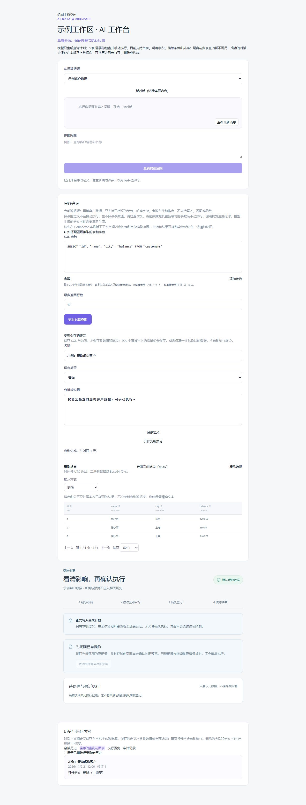

# 第九阶段 G5：MCP 整体联调与验收

当前连续交付构建及已确认问题的最新复验汇总见 [第 39 号记录](39-连续交付验证与审查记录.md)。下文保留各次构建的过程证据，不能把较早的临时门禁、测试数量或“修复中”描述作为当前源码的结论；未完成的真实客户端最终验证仍明确保留。

用户同意开始 G5。本记录根据实际执行情况更新；进入 G5 不自动代表 G4 的所有限制或整个第九阶段已获最终验收。

当前状态：本机受测组合的技术验证完成，待统一用户阶段审核；保留一项非阻断测试目录部分创建失败的 P3。最终支持范围、当前候选产物与测试/原生复核结论见第 39 号记录。下文为各次构建的历史证据，不能把较早的进行中或临时关闭状态视为当前源码。可复现使用入口和操作说明随 Community 候选包提供，未修改或启动用户原环境。

## 本次边界

- 只使用本轮新建的独立 MySQL 实例、随机凭据服务和虚构数据，不连接、迁移、修复或重置用户原有数据库。试用环境和自动化验证使用各自实例，生命周期分别管理。
- 实际客户端联调应证明初始化、发现与调用的真实交互；仅验证 SDK 测试客户端或进程存在不等于第三方客户端兼容通过。
- 使用隔离的客户端配置及合成请求，不更改用户全局客户端配置，不读取真实外部账户密钥，也不自动向外部模型发送项目或业务内容。实际外部供应商和账号必须按用户已确定的展示、确认及凭据边界处理。
- 产品正常启动的数据库写入门禁保持关闭。若验证隔离写入组合，须遵守第八阶段已审核的全部授权和目标隔离要求，不能把测试装配当成正式启用。
- 当前 Git HEAD 为 `d14ab200e283087d06f6fa06b16a450830b071bc`，开始 G5 时存在 G3/G4 未提交改动；它不是 G5 的干净基线。不得为审查擅自提交、重置或暂存已有工作。

## 验收矩阵

| 项目 | 当前状态 | 证据与限制 |
| --- | --- | --- |
| 持续本机试用 | 已启动，后续整理中 | 独立平台、Connector 和样例数据；已验证实际登录、只读查询及一次重启后的数据保留。运行快照与后续工作区代码有版本差异。 |
| MCP Server 实际客户端 | 进行中 | Claude Code 的 stdio 发现和调用已有初步观察；撤销、协议证据和异常清理正在按审查结果加固，最终代码回归仍待验证。 |
| MCP Client 实际服务 | 受阻 | Memory 与 Everything 曾完成限定本机组合调用；定向复审发现安全问题，新源码中调用正按失败关闭处理。 |
| 授权与隐私 | 待验证 | 工作区隔离、凭据目标、撤销与会话失效、逐次确认、结果披露及日志脱敏。 |
| 错误与恢复 | 待验证 | 中断、取消、超时、未知结果、进程退出和重启不自动重放。 |
| 现有功能回归 | 待验证 | 已实现的登录、工作区、Connector、只读查询、历史及审计不回退。 |
| 代码原生复审 | 进行中 | 客户端和草稿交接均已执行初审及定向复审，发现的问题仍在处理；不声称隔离了无关既有差异。 |

计划和完整准入清单见 [第九阶段设计](26-第九阶段MCP设计与验收计划.md)，现有 G4 本机证据见 [G4 记录](29-第九阶段G4实施与审核记录.md)。MySQL 8.0、其他操作系统、分离主机和公网部署均需单独证据；不得从本机测试推断已通过。

## 已核实的完整性缺口

G1 设计要求 `change_propose` 只交接有界、短期、一次性的结构化草稿，绑定实际授权、工作区、数据源和内容承诺；管理员必须主动接收，再独立预览并确认。G5 开始时 G3 只读 Server 尚未接入该工具，不能用阶段 8 原有人工作业测试代替 MCP 组合验收。本轮已接入隔离装配并验证正常确认和重试，但审查发现的授权期限、绑定变化和异常恢复问题仍未完成处理；普通平台的写入入口继续关闭，不将 G5 标记通过。

## 当前本机试用证据

本轮另建端口 13309 的独立实例，平台与样例数据源使用独立 schema 和受限只读账号；平台、Connector 的状态及凭据域与用户原环境分离。实际浏览器通过 Better Auth 登录试用账号，进入“示例工作区”，打开预先保存的“示例：查询虚构客户”，检查 SQL 后手动执行。平台通过配对 Connector 访问隔离样例数据库，返回三条虚构记录；界面提示正式写入未开放。浏览器没有调用真实模型或外部服务。

当前地址是 `http://127.0.0.1:5188/`，独立进程未设置定时关闭；管理账号为 `admin`。凭据仅在当前 Windows 用户的独立系统凭据条目中，通过本次试用专用交互脚本读取，不写入文档或普通日志。已在独立实例核验身份后执行过一次停止和重启，重启后管理员、工作区、数据源、三条虚构客户、历史和只读查询均保留；之后追加的进程创建时间与命令指纹校验仅做过不停止服务的验证，未重复完整启停。独立检查随后确认启动时固定 PID 路径校验和启动失败回收存在缺口，已在读配置或创建进程前禁止两个启动入口；当前运行中的页面不受影响，启动修复及完整复验尚未完成。意外断电、操作系统重启遗留锁或 PID 被复用时，不自动清理或推断所有权。

API 与网页均使用本次启动时的独立运行快照；网页已换为固定构建，不再热更新工作区源码。API 构建时间为 2026-11-02 12:33:54 UTC，网页构建时间为 11:42:47 UTC；后续源码改动不自动进入当前试用环境。安全更新、回滚和自动恢复仍待实现并验证，本环境不能视为正式部署方案。

该试用进程仍是旧快照，尚未包含外部 MCP 调用的服务端安全关闭；源码层面的关闭不影响已运行进程或撤回已发送的请求。不要使用此试用环境调用外部 MCP 工具；只有验证后的新进程才会应用当前门禁。

## 真实 Claude Code 初次验证

本机 Claude Code 2.1.312 使用独立空配置、合成密钥和本机回环模型模拟器，实际通过 Shuriva 的本机 stdio 适配器发现六个工具并调用 `workspaces_list`。初次记录显示协议版本为 2026-07-28；撤销授权后，新的客户端进程未获得该工具或结果。原生代码审查发现版本提取和撤销断言的证据不足，仍需完善并重测，不能据此认定协议或撤销测试通过。该实验使用独立 13308 实例，收尾核验测试 schema/合成账号为零后关闭，PID 和端口均已释放。没有使用用户真实账号或模型密钥，也未证明操作系统级网络隔离。相关可重复测试和故障清理正在完善；在后续 MCP 代码修改结束后须基于最终构建重新运行，才能作为本次 G5 最终回归证据。

异常情况下测试无法充分证明 Claude 的完整子进程树已退出，因此该自动测试目前无条件跳过，不能通过环境开关启用。修复需要可验证的受控进程树、超时和取消清理；本机程序签名核验是独立事实，不能替代上述测试。

## 官方参考服务的初步验证与兼容性

在独立实例及合成数据上，MCP 官方 Memory 参考服务经本地安装、授权与发现后，执行单独批准的只读 `read_graph`，返回空图；未调用写入工具。该结果仅说明这一具体本机组合的初步行为，不代表商业供应商或远程服务已通过。

可重复测试使用操作者明确选定的 2.0.1 包，检查其声明的名称、版本和许可证，并验证未经批准的调用被拒绝以及重复确认只有一次成功。包元数据本身不能证明供应链来源；测试不联网安装，选用包的可信性仍由操作者确认。

官方 Everything 参考服务的初始直接 SDK 发现返回 22 个工具；改造前产品因部分工具使用不支持的结构而拒绝整份清单，未执行任何工具，也未保存部分审批。现已实现逐项隔离，完整原始清单仍受限并绑定版本，不支持的工具不得批准或调用。

修复后使用独立实例和选定的 Everything 2.1.0 包完成产品链路测试 2 项：发现 22 个工具，其中 3 个不支持项无法批准或调用；`echo` 未批准时拒绝，批准并逐次确认后实际成功调用一次，观察请求未出现 `Mcp-Param-*` 或常见认证头。异常清理验证本次直接 Node 服务进程退出，不能证明潜在后代进程已回收。包元数据不能独立证明发布者身份，测试使用操作者明确选择的包；这不代表其他服务或公网场景已通过。

首次针对客户端改造的 Codex 原生只读审查已完成，报告两项 P1（响应关联及工具清单变化后的授权失效）和三项 P2（结构上限、畸形描述和意外编译异常处理）；正在核实修复并增加回归，尚不能认定复审通过。审查按文件和调用链的提示词限定范围，Git HEAD 不是本轮干净基线，不等于工具强制隔离增量。

针对上述五项已完成首轮修改：无数据库 SDK 传输与发现测试 9 项、API 边界测试 7 项及界面测试 5 项通过，覆盖响应 ID 混淆、工具清单通知、发送前变更、结构上限、畸形输入和异常处理。实际 Everything 服务回归见上；这些测试不替代定向复审和最终回归。

第一次定向原生复审随后报告两项 P1 和六项 P2，涉及变更通知订阅、排队发送与变更竞争、非发现阶段的响应关联、未发送结果、结构上限和非法/不支持结构的区分；正在依据 SDK 实际行为逐项核实。此前通过的测试和 Everything 回归不能替代这些问题的修复及最终复验。

已核实 SDK 不会在当前配置下自动订阅所需的工具变更通知；HTTP 与 stdio 的排队发送也尚缺少可证明的物理交接或取消边界。为此正在服务端关闭外部 MCP 工具调用并在界面说明；恢复调用须先设计并验证订阅生命周期、失联处理和交接边界。此前成功调用只反映关闭前的测试状态，不能证明当前能力已开放或安全。

针对临时关闭措施的原生复审进一步发现 SDK 直接调用路径可绕过上层门禁，正下沉到传输边界处理；另有发现阶段的异常及 schema 兼容性问题待核实。最终保护仍须在修复后测试和复审，不能把初步门禁当作已经完成的安全保证。

后续复审又指出序列化可能改变实际发出的消息，及发现结果提交时 transport 错误与数据库 COMMIT 的顺序无法可靠证明。前者正在按最终序列化结果核验；后者暂以服务端关闭新发现处理，已有清单只作为可能过期的历史查看，不是实时或可授权结果。连接管理与历史查看保留，相关关闭仍需测试和原生复审。

当前源码已对最终序列化消息进行校验，并关闭发现、调用与新增批准；管理员仍可通过单独受权且审计的操作撤销所有已有批准。实际 SDK 伪装和零额外网络请求测试，以及独立数据库的会话、归属与撤销测试已有初步通过结果；当前关闭措施仍在做定向原生复审。已运行的旧版试用进程不自动加载这些改动。

后续针对关闭措施的定向原生复审未报告调用绕过，但报告三项 P2：底层传输错误可能未脱敏、进程清理无法证实仍可能被说成断开成功、其他会话的批准可能不显示撤销入口。正在核实修复，不能据此认定整条管理链已复审通过。

对上述修复的最新定向原生复审仍报告七项 P2，涉及关闭与启动并发的进程所有权、嵌套发送和直接关闭的错误脱敏、多次清理的等待、连接摘要的清理未知状态、并发关闭返回值以及未授权撤销的副作用。由于多轮复审仍有发现，本轮不将这些路径记为通过；外部发现与调用保持关闭，相关问题须在恢复能力前逐项核实、修复、测试和定向复审。

兼容性改造改变了工具快照的当前数据结构。若原开发环境已保存非空旧形状快照，相关工作区的 MCP 连接列表可能无法读取，现有界面也无法直接重新发现或停用。是否存在此类数据未知，本轮不会查询或修改用户原数据库；如确有影响，需另行确认并授权针对受影响连接处理派生快照及审批，不能自动清除数据。

## 写入草稿交接的初步验证

隔离测试覆盖了实际认证、HTTP 领取与回执、跨会话和重复领取拒绝、撤销后的管理员独立操作，以及修改草稿后预览来源的审计关联；并覆盖事务超时回滚与撤销并发锁。此轮预览使用受控替身，不能证明真实 Connector 或浏览器全流程；普通启动的写入门禁仍保持关闭。

另一次独立测试通过 MCP SDK 提交草稿、管理员经 HTTP 领取并回执，再通过带来源审计的预览调用真实 Go Connector，返回一行预览；测试前后隔离数据一致，没有确认或执行写入。

补充的独立真实写入测试使用实际管理员 HTTP 确认一次，隔离订单产生预期变化；同一 MCP 请求重试只返回已交接状态，平台执行记录和 Connector 原子回执均恰好一条。该测试没有使用用户原数据库，正式写入门禁仍保持关闭；它尚不是浏览器点击贯通测试。

另一轮独立浏览器测试使用专用页面和注入的合成管理员会话，实际领取 MCP 草稿、恢复隔离范围、查看真实 Connector 返回的订单前后差异并确认一次；页面显示实际变更一行，测试库核验只有一条已提交执行。该测试不是对登录流程的重新验收，且不涉及用户原数据库。

独立真实浏览器页面使用虚构响应验证了成功回执后显示写入界面，以及撤销导致回执失败时清除草稿并隐藏编辑器。这是桩服务下的界面测试，与真实 Connector 测试是两项独立证据，不能视为浏览器到真实 Connector 的完整贯通。

独立 HTTP 断线测试在收到响应头后断开并且不消费草稿，调用保持 `handoff_unknown`，再次领取被拒绝。该测试不代表所有网络故障已覆盖，也没有执行数据库写入。

本机 stdio 补充了隔离正反例：默认关闭时不暴露写草稿，测试装配开启后可交接草稿，撤销后拒绝；该工具不提供确认或执行操作。后续代码修改和原生复审后仍需按最终版本回归。

草稿参数限定为 24,576 UTF-8 字节和 1,800 个 JSON 值节点。管理员预览的来源证明保存在服务端有界内存中，最多 128 条；重启或淘汰后无法验证来源时，新的来源关联预览失败关闭。

首次针对草稿交接调用链的 Codex 原生只读审查已完成，报告八项 P2，涉及 stdio 工具发现、授权到期与回执事务、确认期间导航及目标展示、草稿与传输大小边界、浏览器超时和测试前置条件。上述问题正在核实修复，后续需针对修复位置和调用链重新复审。审查使用提示词限定文件及调用链；由于已有未提交工作，Git HEAD 不是本次干净基线。

首次定向复审又报告四项 P2：提交期间授权过期、回执自身过期、数据源绑定变化及异常核对时无法安全离开，现正核实处理；不能以此前正常流程测试替代这些并发与恢复验证。

由于当前数据源绑定没有可证明唯一的绑定版本，源码已将 MCP 草稿的来源关联预览临时设为失败关闭；可靠绑定版本及其保留数据的显式迁移方案仍待完成。先前的真实浏览器与 Connector 测试仅代表该关闭前的构建，不能证明当前版本仍可执行。回执正在改为持久保留未知状态，避免将无法证明提交时序的结果写成已交接；最终代码和界面语义仍待测试和复审。

最新隔离回归中，真实 HTTP 断线、回执持久未知及行锁等待期间授权到期等四项通过；真实 Connector 测试确认未版本化来源不能到达预览或执行，业务数据不变。测试使用独立实例，完成后已清理并关闭。

针对回执和门禁的定向原生复审没有报告服务端绕过，但报告了共享写入界面的两项恢复问题；另一次恢复界面复审报告六项 P2。当前界面仍在修改，这些复审不能作为最终版本通过证据，需继续核实及复测。

对恢复界面后续修复的定向复审再次报告六项 P2，涉及封存时绑定核验、恢复屏障、离线历史、过期显示和恢复路径预览门禁，现正处理。多轮发现意味着不能用此前的 27 项界面测试声称最终恢复流程已通过。

后续修复的恢复相关测试 38 项通过；最新网页测试 144 项通过。最新构建、类型检查、静态检查、格式检查和依赖边界检查通过；针对最终安全门禁、草稿处理及日志的测试 43 项通过、1 项因安全关闭跳过。最近一轮完整默认 API 回归为 236 项通过、114 项按条件跳过，但它先于随后错误脱敏与清理处理的修改，不能等同于当前源码的完整回归。网页构建提示主包较大，需后续评估加载性能。

截至本记录，关闭措施的最新定向原生复审报告七项待核实问题，恢复界面的最新定向原生复审报告六项问题；两处均未通过。两项能力的恢复方案分别见 [外部工具调用安全边界设计](31-第九阶段MCP工具调用安全边界设计.md) 和 [草稿绑定版本设计](32-第九阶段草稿绑定版本修订方案.md)；两份方案均待审核、尚未实现或验收。

恢复界面最近一次定向复审仍报告两项 P2：历史读取失败缺少独立只读重试，待核对期间不能浏览已加载的历史。正在局部核实处理，当前不能记为恢复流程复审通过。

对上述局部修复的进一步复审又报告四项 P2，涉及数据源不可用时的只读查看、待核对期间列表快照标识、失效选择的清理和历史读取的登录/授权提示。当前继续局部处理；由于多轮复审均有发现，G5 的恢复体验不能按已通过交付。

对四项修复的最新定向原生复审仍报告六项 P2：普通状态下离线历史详情不可读、采用新确认结果或访问失效后旧详情可能保留、历史错误可能被其他提示遮盖、能力请求的授权失败被当作连接故障，以及权限恢复后缺少历史刷新入口。已对普通状态下调用 `refresh()` 和能力请求错误被统一处理的代码做只读核对；其余项仍需逐项复现与核实。多轮发现不能无限重试，本轮保留未通过状态，不把测试通过当作解决这些问题。
